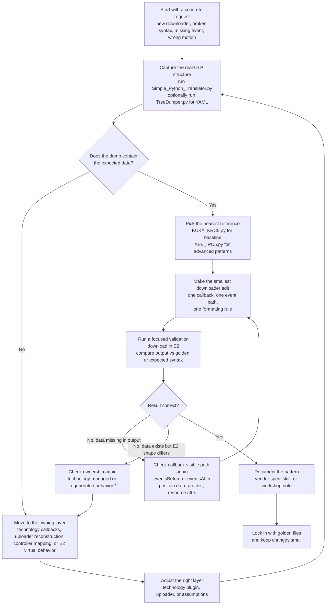

# Agentic Downloader Development Loop

This page shows the typical workflow for using Copilot and the repo skills to build or debug an E2 downloader with the shortest possible feedback loop.

## Typical Loop

## Practical Reading Of The Loop

1. Start from the tree, not from the generated robot file alone.
2. Use `Simple_Python_Translator.py` as the default first diagnostic step.
3. Use `TreeDumper.py` when you need structured diffs or round-trip investigation.
4. Only patch the downloader after the dump proves the data is present in the callback-visible OLP tree.
5. If the data is absent or gets regenerated by E2, stop patching the downloader and move to the real owner.

## Typical Owners

- Downloader: vendor syntax emission, formatting, output ordering, mapping callback-visible data to robot code
- Technology: workmethods, virtual helper motions, generated approach or retract behavior, controller-specific tech rules
- Uploader: rebuilding OLP structure from external text or intermediate YAML

## Typical Validation Loop

1. Trigger a download in E2 with the active downloader.
2. Compare the output with a golden file or a known-good sample.
3. If behavior is unclear, capture a tree dump and inspect the exact motion or event path.
4. Make one narrow change and rerun the same validation.
