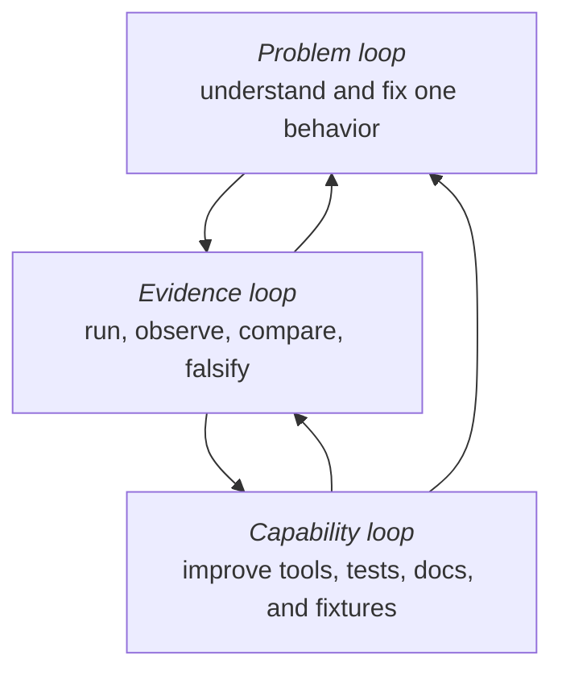
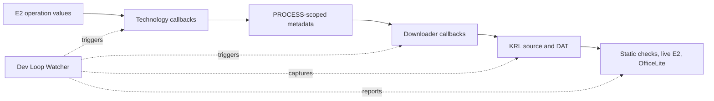
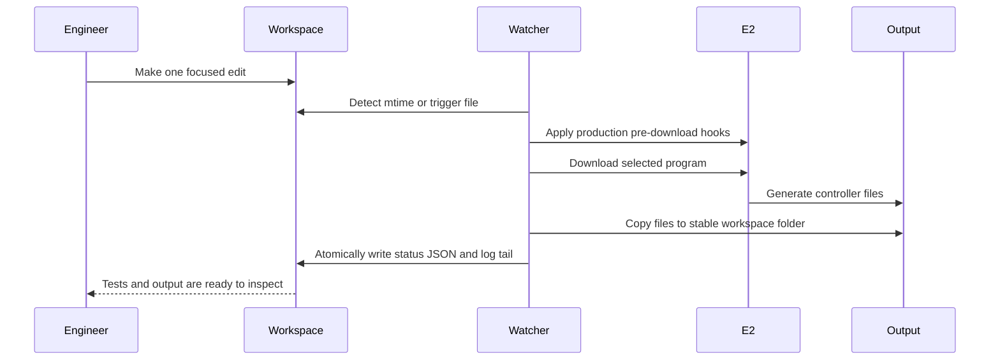
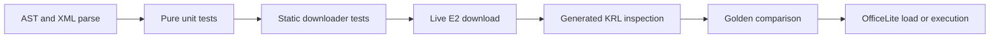
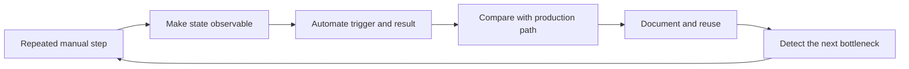

# Loop Engineering: From Repeated Debugging to a Development System

This guide uses a real FASTSUITE E2 customization session as a case study in loop
engineering. It is written for project engineers, technology authors, downloader authors,
reviewers, and teams introducing agent-assisted development.

The controller-specific result matters, but it is not the main lesson. The main lesson is
that a difficult implementation became tractable when the team improved the feedback loop
itself: observe real runtime state, automate the expensive repetition, preserve production
fidelity, and turn each discovery into a reusable tool or documented rule.

## What Is Loop Engineering?

Loop engineering is the deliberate design of the cycle that turns a hypothesis into verified
evidence.

It asks more than "How do we fix this bug?" It also asks:

- How quickly can we run the next discriminating experiment?
- Does the experiment exercise the same path as production?
- Can another engineer reproduce the result?
- Which manual step should become a tool before we repeat it again?
- What evidence prevents a regression in older configurations?

Three loops operate together:



The problem loop delivers today's feature. The capability loop makes tomorrow's feature
cheaper, safer, and easier to explain.

## Case Study

The session extended a KUKA Arc Welding downloader and technology integration with:

- KUKA SeamTech Finding and Tracking 4.0.3 compatibility;
- KUKA ArcTech MultiLayer output with LIN and CIRC geometry;
- backward-compatible output for earlier option-pack versions;
- current operation geometry rather than stale recipe snapshots;
- transactional fallback to byte-preserved native output;
- focused static tests, pure emitter tests, live E2 downloads, and pending OfficeLite gates.

The difficult part was not one syntax rule. Several ownership and lifecycle boundaries met in
the same behavior:



The first implementation assumptions were plausible but incomplete. Runtime evidence changed
the model several times.

## How The Understanding Changed

| Observation | Initial interpretation | Discriminating evidence | Resulting rule |
|---|---|---|---|
| Edited process-table geometry did not affect AML | Recipe metadata was not refreshed | Runtime probes showed native operation values had changed while stored recipe provenance had not | Keep provenance immutable; mirror current native geometry before download |
| Downloader reads returned missing or invalid values | The attribute names or getters were wrong | Tree and runtime inspection showed built-in values did not carry download-visible `PROCESS` scope | Hand off values through explicit PROCESS-scoped metadata |
| Generic getters did not expose all native geometry | The values were absent | Typed system getters returned sheet, path-boundary, and contour values | Use dedicated system-attribute APIs for built-in attributes |
| Watcher runs still used old helper behavior | The latest edit was incorrect | A freshness probe showed the callback reloaded but its imported helper remained cached | Restart E2 or explicitly reload helper modules in a development watcher |
| Generated offsets were `0.003` instead of `3.0` | Geometry mapping was wrong | Live KRL inspection exposed an SI metres to KRL millimetres boundary | Convert units only in the controller-specific projection |
| A broad 4.x branch looked sufficient | New syntax applied to all 4.x versions | The available witness was specifically version 4.0.3 | Gate new syntax at the exact evidenced version and retain an explicit legacy branch |

This sequence is normal in runtime integration work. Good loop engineering does not eliminate
wrong hypotheses. It makes them cheap to disprove.

## The Watcher Was The Highest-Leverage Improvement

The `DevLoopWatcher` changed the economics of the session. Before it, every experiment required
a person to return to E2, find the program, click Download, collect output, and report the result.
After it, a file change or trigger file initiated the run, and a machine-readable status file
returned the outcome to the engineer or coding agent.



### Why This Is More Than Convenience

The watcher improved:

| Property | Manual loop | Watcher-assisted loop |
|---|---|---|
| Trigger | Human navigation and clicks | File change or explicit JSON trigger |
| Result handoff | Verbal report or copied log text | Atomic status JSON |
| Output collection | Manual file lookup | Stable copied output paths |
| Repetition | Easy to skip or vary | Same action every run |
| Agent participation | Stops at the E2 boundary | Can inspect status and generated files |
| Multi-program runs | Repeated manual selection | Configured program list or sentinels |
| Failure context | Often lost between attempts | Return codes, error, and ring-buffer log tail |

Reducing one manual action is useful. Removing an entire human handoff from every experiment is
transformative. It lets the engineer spend attention on interpretation rather than operation.

### Production Fidelity Is A Requirement

Automation is dangerous when it tests a different path from the real workflow. In this case,
`DownloadProgramByName()` bypassed AutoExecute behavior used by the E2 Download button. The
watcher therefore had to invoke the relevant pre-download planning explicitly.

The rule is:

> A fast loop is valuable only when its result predicts production behavior.

For every watcher or harness, document:

1. which production entry point it replaces;
2. which lifecycle hooks that entry point normally invokes;
3. which hooks the harness must reproduce explicitly;
4. how output equality with the production path was checked.

### A Reusable Watcher Contract

A development watcher should provide these capabilities:

- explicit configuration for workspace, watched files, programs, output, trigger, and status;
- both automatic file-change triggers and explicit machine-written triggers;
- active-program, named-program, and all-program selection where appropriate;
- production-equivalent pre-download behavior;
- collection of generated paths after every individual download;
- deterministic output copies in the workspace;
- atomic status writes so readers never see partial JSON;
- bounded log capture rather than unbounded process memory;
- clear success criteria based on return codes;
- explicit error reporting without terminating the watch loop;
- a stop mechanism;
- deliberate helper-module reload behavior for development.

Do not hide missing lifecycle equivalence behind a green status. A watcher that reports success
for the wrong execution path makes the loop faster in the wrong direction.

## What Went Well

### 1. The Work Started From Concrete Evidence

The session used real controller samples, E2 tree/runtime data, generated KRL, and focused tests.
When sources disagreed, runtime behavior and the repository's API-authority rules decided the
next experiment.

### 2. Ownership Was Revisited Instead Of Defended

The downloader initially appeared to own the whole problem. Evidence showed that current
geometry had to be materialized in the technology layer before the downloader could consume it.
Moving the handoff to `PrevProgramDownload` fixed the lifecycle problem at its owner.

### 3. Validation Was Layered

The session did not treat one green check as universal proof.



Each layer proves something different. For example, a unit test can prove deterministic
rendering, while only live output exposed the metres-to-millimetres error.

### 4. Backward Compatibility Was An Explicit Design Constraint

New syntax was gated on exact option-pack versions. Legacy branches remained visible and tested.
Unsupported geometry used transactional fallback: capture native output, attempt AML, and commit
only when the whole seam is valid.

### 5. Knowledge Was Captured At The End

Reusable platform lessons went to skills and documentation. Vendor syntax stayed in KUKA specs.
Open evidence gaps remained explicit instead of being promoted to facts.

## What Could Be Improved

### Preparation By The Requester

The fastest session starts with an evidence packet, not only a feature sentence.

Prepare these items before the session:

- exact E2, controller, and option-pack versions;
- one smallest program that demonstrates the desired behavior;
- one earlier-version or native program that must remain unchanged;
- controller-authored or OfficeLite-taught samples, when available;
- the expected output fragment and the current incorrect fragment;
- a tree dump or structured YAML for the same program;
- source-of-truth decisions, such as whether recipe data or edited operation data wins;
- a scenario matrix naming each case and expected result;
- the strongest validation environment currently available;
- known constraints, including unsupported directions, motions, or option packs;
- confirmation that E2, OfficeLite, MCP servers, and watcher configuration are ready.

This avoids spending early iterations discovering which version, fixture, or value is
authoritative.

### Session Scoping

Start with one end-to-end scenario. Prove its observation and execution path before multiplying
the matrix. In this session, separating 2D and 6D scenarios was useful, but that distinction
would have been even more efficient if fixed at the beginning.

Use a table like this:

| Scenario | Version | Geometry | Sensing | Expected branch | Validation |
|---|---|---|---|---|---|
| Baseline legacy | earlier option pack | LIN | legacy Finding | native/legacy | byte comparison |
| New minimum | 4.0.3 | LIN | 2D | new syntax | E2 plus OfficeLite |
| Geometry extension | 4.0.3 | CIRC | 2D | AML | E2, then OfficeLite |
| Alternate correction | 4.0.3 | CIRC | 6D | AML | E2, then OfficeLite |

### Tooling Earlier In The Session

The watcher became essential, but the general lesson is to automate after the second repeated
manual cycle, not after the tenth. Repetition is evidence of a missing tool.

Before implementation begins, ask:

- Which action will we repeat after every edit?
- Can it be triggered from a file or command?
- Can its result be written in a machine-readable form?
- Does automation preserve the production lifecycle?
- Can generated output be copied to a deterministic location?

### Cleaner Evidence Checkpoints

Keep a short experiment log during the session:

```text
Hypothesis:
Smallest change or probe:
Scenario:
Observed result:
Decision:
Remaining uncertainty:
```

This prevents stale assumptions from returning after a long implementation sequence and makes
handoffs or context compaction safer.

### Protect The Editing Surface

Legacy scripts can contain unusual indentation and formatting. Before changing a large method,
run a tiny compile or AST probe against the smallest edit. If automated patching repeatedly
damages the same boundary, extract a pure helper instead of fighting the file's formatting.

## A Repeatable Loop-Engineering Workflow

### Phase 0: Define The Claim

Write one falsifiable statement:

> For scenario X, version Y emits behavior Z, while earlier versions preserve behavior W.

List what would disprove it.

### Phase 1: Establish Observation

Confirm that you can see:

- the input object tree;
- callback-visible attributes and scopes;
- generated output;
- runtime logs and return codes;
- the independent reference or expected result.

Do not implement against data you cannot observe.

### Phase 2: Capture A Baseline

Run the unchanged path. Save native output, tree dumps, versions, and validation results. A
baseline recorded after the change is not a regression baseline.

### Phase 3: Run The Cheapest Discriminating Probe

Choose the smallest experiment that distinguishes the current hypotheses. Examples include:

- log one typed getter and one generic getter;
- inspect one operation's attribute scope;
- emit one unit-sensitive value;
- compare one callback path with the UI path;
- use a freshness marker to detect stale imports.

### Phase 4: Improve The Loop

When a manual step repeats, automate it. Add structured status, deterministic output capture,
and focused tests. Validate the tool against the manual production path before trusting it.



### Phase 5: Harden Compatibility And Failure

Use exact version gates. Keep old branches explicit. Make multi-step output transactional when a
partial result would be invalid. Prefer safe fallback over partially transformed output.

### Phase 6: Close With Evidence

Record:

- checks that passed;
- checks that failed and why;
- runtime environment and versions;
- unsupported cases;
- independent validation still required;
- reusable discoveries that belong in skills, specs, or the shared vault.

## Session Readiness Checklist

Use this checklist before inviting coworkers or an agent into a runtime integration session.

- [ ] The problem is expressed as a falsifiable behavior claim.
- [ ] Exact software and option-pack versions are recorded.
- [ ] One minimal positive scenario is ready.
- [ ] One compatibility scenario is ready.
- [ ] Current and expected output are available.
- [ ] A tree dump or equivalent structural observation is available.
- [ ] Runtime ownership assumptions are written down.
- [ ] The production validation environment is running.
- [ ] Repeated actions have a watcher, task, or script where practical.
- [ ] The automated path has been compared with the manual path.
- [ ] Output and status have deterministic workspace locations.
- [ ] Golden provenance is independent of the implementation under test.
- [ ] Known evidence gaps are named before work starts.
- [ ] Repository and external knowledge sources are connected.

## Measuring Whether The Loop Improved

Track a few practical measures rather than only feature completion:

| Measure | Question |
|---|---|
| Evidence latency | How long from saving an edit to seeing a trustworthy result? |
| Manual touches | How many human actions are required per experiment? |
| Reproducibility | Can another engineer trigger the same case and get the same artifacts? |
| Production fidelity | Does the harness execute the same lifecycle as the real command? |
| Failure visibility | Are return code, error, logs, and generated paths captured together? |
| Regression confidence | Which older scenarios run automatically? |
| Capability gain | What new tool, fixture, test, or note makes the next task easier? |

The goal is not zero human involvement. The goal is to reserve human attention for judgment,
domain interpretation, and evidence quality.

## Suggested Team Presentation

For a 30-minute coworker session:

1. **5 minutes - The problem:** show the feature request and why several layers owned parts of it.
2. **5 minutes - The failed assumptions:** walk through scope, callback timing, module caching,
   and units.
3. **8 minutes - The watcher:** demonstrate edit, automatic download, status JSON, and copied
   output.
4. **5 minutes - Validation ladder:** explain what each check proves and does not prove.
5. **5 minutes - Preparation:** review the readiness checklist and scenario matrix.
6. **2 minutes - Takeaway:** improve the loop whenever repeated work or missing evidence slows
   the next decision.

The most useful live demonstration is deliberately small: change one observable value, let the
watcher trigger one program, inspect the status, and compare the generated output. The audience
should see the feedback loop, not a long controller program.

## Anti-Patterns

- Patching the downloader when the expected data is absent from the callback-visible tree.
- Treating a static test as proof of runtime lifecycle behavior.
- Automating a shortcut that bypasses required production hooks.
- Regenerating a golden from the implementation it is meant to verify.
- Broadening a version branch beyond the available evidence.
- Repeating manual clicks without investing in a watcher or task.
- Hiding unsupported cases behind partial output.
- Keeping session discoveries only in chat history.

## Related Guides

- [Agentic Downloader Development Loop](agentic-downloader-development-loop.md)
- [Daily Workflow](daily-workflow.md)
- [Getting Started](getting-started.md)
- [Git Essentials](git-essentials.md)
- [KUKA Multilayer working notes](../ctrl-specific/KUKA/current.md)
